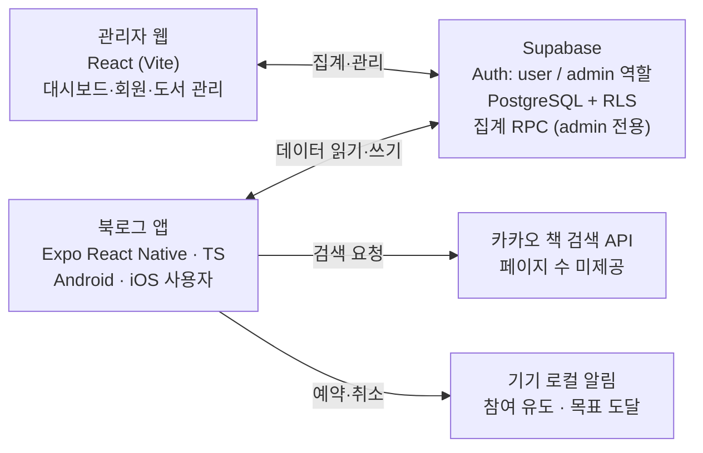

# BookLog MVP PRD (Draft)

> 최종 수정: 2026-11-04 · 작성: 한인웅
> 원본: Claude 문서 「북로그(BookLog) MVP PRD 초안」. 이 파일은 저장소에서 사람과 AI 에이전트가 참고하기 위한 사본이다.

## 1. 개요

북로그는 독서 목표를 하루 단위의 작은 행동으로 나누고, 독서를 시작하고 이어가도록 돕는 모바일 독서 습관 앱이다. 이 문서는 수업 기간(9~15주)에 구현할 MVP의 요구사항을 정의한다.

**배경·문제**

- 성인 연간 종합독서율은 2023년 43.0%에서 2025년 38.5%로 4.5%p 떨어졌다 (문화체육관광부 「2025년 국민 독서실태 조사」).
- 20대 종합독서율은 75.3%로 높지만, 읽고 싶은 마음이 있어도 지속하지 못하는 사용자층이 핵심 타깃이다.
- 기존 독서 앱(북모리, 북적북적)은 기록에 강하지만 독서를 시작·유지·재개하게 만드는 장치가 약하고, 습관 앱(루티너리)은 독서 맥락과 연결되지 않는다.

**해결할 문제 3가지**

| # | 문제 | 해결 방안 |
| --- | --- | --- |
| 1 | 결과 중심 목표라 오늘 얼마나 읽을지 기준이 없음 | 분·페이지 단위 행동 목표 설정 |
| 2 | 습관 유도 기능이 없거나, 기록과 동떨어져 능동적 유도가 없음 | 독서 데이터와 연동한 맥락 알림 + 진행 기반 보상 |
| 3 | 기록 방식이 부담스러움 (구절·생각 직접 타이핑) | 인덱스: 페이지와 짧은 제목으로 기록, 문장은 선택 |

**제품 목표**

1. 부담 없는 목표로 독서를 시작하게 한다.
2. 읽는 동안 집중을 유지하게 한다.
3. 기억하고 싶은 내용을 가볍게 남기게 한다.
4. 과정과 결과를 시각적으로 확인하게 한다.
5. 멈춘 책을 다시 펼치게 한다.

## 2. 대상 사용자와 핵심 시나리오

주 사용자는 독서 의향은 있지만 꾸준히 읽지 못하는 20대이고, 운영자는 관리자 웹으로 서비스 지표와 데이터를 관리한다.

| 사용자 | 설명 | 주요 사용 채널 |
| --- | --- | --- |
| 일반 사용자 (user) | 책을 사 두고도 끝까지 못 읽는 20대 대학생·직장인 | 모바일 앱 (Android·iOS) |
| 운영자 (admin) | 서비스 지표 확인, 회원 이용 정지, 도서 정보 정정 | 관리자 웹 |

**핵심 사용 흐름:** 목표 설정 → 오늘의 독서(타이머) → 기록 → 스트릭 반영 → 인사이트 → 다시 독서

**시나리오 (스토리보드 기준)**

1. **시작하기:** 첫 실행 시 온보딩에서 "하루 15분" 같은 목표와 요일·알림 시간을 정한다. 홈에 오늘의 목표 카드가 나타난다.
2. **책 고르고 읽기:** 책을 검색해 서재에 추가하고 총 페이지를 입력한다. 책 상세에서 독서를 시작하면 집중 독서 모드가 켜지고, 앱을 벗어났다 돌아오면 반응 메시지가 뜬다.
3. **읽으며 남기기:** 읽다가 인덱스(페이지 + 짧은 제목)를 남긴다. 독서를 끝내면 끝 페이지와 한줄평을 입력하고, 다 읽으면 별점·총평으로 완독 처리한다.
4. **기록 확인하기:** 기록 탭에서 캘린더·주간 달성률·연속 독서일을, 인사이트 탭에서 달성률 카드를 본다.
5. **다시 시작하기:** 목표 요일에 읽지 않으면 알림이 온다. 서재에서 오래 안 읽은 책에 쌓인 먼지를 스와이프로 털면 바로 독서가 시작된다.

## 3. MVP 범위

MVP는 핵심 사용자 흐름과 특수 기능 3종(★)을 단순 버전으로 구현하고, 연출·자동화·운영 기능은 학기 이후(P1·P2)로 미룬다.

**포함 (P0, 9~15주)**

- 앱 로그인 생략 (테스트 계정 자동 로그인), 관리자 권한·관리자 웹 로그인
- 목표 설정 (시간·페이지·요일·알림 시간), 온보딩, 설정 화면
- 도서 검색·등록·서재·상태 관리, 책 상세
- 타이머·페이지 기록·세션 저장
- ★ 집중 독서 모드, 목표 도달 알림
- ★ 인덱스 (페이지 + 짧은 제목)
- 완독 처리 (별점·총평)
- 캘린더·달성률·연속 독서일, 인사이트 달성률 카드, 홈 화면
- ★ 책꽂이 성장 UI·먼지털이 (단순 버전)
- 참여 유도 알림 (고정 문구)
- 관리자 웹: 대시보드·회원 관리·도서 관리

**제외**

| 단계 | 기능 |
| --- | --- |
| P1 (고도화) | 회원가입·로그인 화면, 독서 노트·모아보기, 상세 통계·리포트, 반복 미달성 시 목표 수정 안내, 먼지털이 효과·책꽂이 연출 고도화, 수동 도서 등록·표지·바코드, 관리자 알림 관리·운영 설정·공지 |
| P2 (확장) | 인덱스 공유 카드, AI 독서 회고, 고급 알림, 베타 테스트·출시 준비 |

원격 푸시는 관리자 공지(P1)에만 쓰이므로 MVP는 로컬 알림만 구현한다.

## 4. 기능 요구사항

요구사항은 8개 모듈 30개이며, 각 항목의 수용 기준을 통과하면 완료로 본다. ★는 특수 기능이다.

상태 값은 `미착수` → `진행 중` → `완료` 순서로 바꾸며, 구현 PR에서 함께 갱신한다 (AGENTS.md의 Documentation Rules 참고).

### 4.1 회원·권한 (AUTH)

| ID | 요구사항 | 수용 기준 | 상태 |
| --- | --- | --- | --- |
| AUTH-01 | 테스트 계정 자동 로그인 | 앱 실행 시 미리 만든 테스트 계정으로 Supabase에 자동 로그인되어 user_id가 정해진다. 앱의 회원가입·로그인 화면은 P1 (관리자 웹 로그인은 ADMIN-01) | 완료 |
| AUTH-02 | 역할 분기 | role=user는 앱, role=admin은 관리자 웹에만 진입한다. 이용 정지된 계정은 로그인 후 안내 화면에서 멈춘다 | 완료 |
| AUTH-03 | 데이터 접근 제한 | RLS로 본인 데이터만 읽고 쓸 수 있다 | 진행 중 |

### 4.2 목표·온보딩·설정 (GOAL)

| ID | 요구사항 | 수용 기준 | 상태 |
| --- | --- | --- | --- |
| GOAL-01 | 온보딩 목표 설정 | 첫 로그인 시 단위(분/페이지), 목표량, 요일, 알림 시간을 입력해야 홈으로 이동한다 | 미착수 |
| GOAL-02 | 목표 수정 | 수정 시 이전 목표에 종료일이 기록되고 새 목표가 적용 시작일과 함께 저장된다. 지난 날짜의 달성률은 당시 목표 기준으로 계산된다. 수정한 날은 새 목표가 기준이고, 같은 날 여러 번 고치면 마지막에 저장한 목표가 기준이다 | 미착수 |
| GOAL-03 | 설정 화면 | 목표 수정, 알림 시간 변경, 알림 켜기·끄기를 할 수 있다 | 미착수 |

### 4.3 도서·서재 (BOOK)

| ID | 요구사항 | 수용 기준 | 상태 |
| --- | --- | --- | --- |
| BOOK-01 | 도서 검색 | 검색어 입력 시 카카오 책 검색 API 결과(표지·제목·저자·출판사)가 목록으로 표시된다 | 진행 중 |
| BOOK-02 | 도서 등록 | 선택한 도서가 Book에 저장되고(ISBN 중복 시 기존 행 재사용), 총 페이지를 입력하면 UserBook이 생성된다. 총 페이지는 1 이상의 정수만 허용한다 | 진행 중 |
| BOOK-03 | 독서 상태 관리 | 읽고 싶음·읽는 중·완독·중단 중 하나로 바꿀 수 있고, 서재 탭별 목록에 즉시 반영된다. 완독을 고르면 완독 처리(READ-05)로 이동한다. 완독한 책 다시 읽기는 MVP에서 지원하지 않는다 | 미착수 |
| BOOK-04 | 책 상세 | 진행률(현재/총 페이지), 인덱스 목록, 독서 시작 버튼을 보여준다 | 진행 중 |

### 4.4 독서 세션 (READ)

| ID | 요구사항 | 수용 기준 | 상태 |
| --- | --- | --- | --- |
| READ-01 | 독서 타이머 | 시작 시각을 저장하고 경과 시간을 `현재 − 시작`으로 계산한다. 앱이 백그라운드에 있다 돌아와도 시간이 맞다. 진행 중 세션(시작 시각·책·이탈 횟수)은 기기에 저장해, 앱이 강제 종료된 뒤 다시 열면 이어하기·종료를 고를 수 있다. 동시에 진행할 수 있는 세션은 1개다 | 진행 중 |
| READ-02 | ★ 집중 독서 모드 | 세션 중 앱이 background → active로 바뀌면 반응 메시지를 표시하고 이탈 횟수를 1 올린다 | 진행 중 |
| READ-03 | 목표 도달 알림 | 시간 목표일 때 타이머 시작 시 남은 목표 시간 뒤로 로컬 알림을 예약하고, 그 전에 종료하면 예약을 취소한다. 페이지 목표는 알림 없이 종료 요약에서 달성 여부를 보여준다 | 미착수 |
| READ-04 | 독서 종료·세션 저장 | 끝 페이지(시작 페이지 이상, 총 페이지 이하)와 한줄평(선택) 입력 후 ReadingSession이 저장되고, UserBook의 현재 페이지·마지막 독서일이 갱신된다. 독서 시간·이탈 횟수 요약이 표시된다. 끝 페이지가 총 페이지와 같으면 완독 처리를 안내한다 | 진행 중 |
| READ-05 | 완독 처리 | 별점(1~5)·총평 입력 시 Review가 저장되고 상태=완독, 완독일이 기록되며 책꽂이에 추가된다 | 미착수 |

### 4.5 ★ 인덱스 (INDEX)

| ID | 요구사항 | 수용 기준 | 상태 |
| --- | --- | --- | --- |
| INDEX-01 | 인덱스 추가 | 페이지와 짧은 제목은 필수, 문장·색상·태그는 선택이다. 독서 중과 책 상세 양쪽에서 추가할 수 있다 | 진행 중 |
| INDEX-02 | 인덱스 목록 | 책 상세에서 페이지 오름차순으로 표시된다 | 진행 중 |

### 4.6 기록·시각화·책꽂이 (VIEW)

| ID | 요구사항 | 수용 기준 | 상태 |
| --- | --- | --- | --- |
| VIEW-01 | 캘린더 | 기록 탭에서 월별 캘린더에 독서한 날이 표시된다. 목표 요일이 아닌 날 읽은 날도 표시한다 | 미착수 |
| VIEW-02 | 달성률 | 목표 요일마다 그날 세션 합계를 그날 적용된 목표량과 비교해 계산한다 (저장하지 않는 계산값). 목표 요일이 아닌 날은 계산에서 뺀다. 주간 그래프로 표시한다 | 미착수 |
| VIEW-03 | 연속 독서일 | 목표 요일만 세어, 오늘까지 끊기지 않고 목표를 채운 일수를 표시한다. 목표 요일이 아닌 날은 건너뛰고, 오늘 목표를 아직 못 채웠으면 어제까지로 계산한다 | 미착수 |
| VIEW-04 | 인사이트 달성률 카드 | 인사이트 탭에서 주·월 달성률 카드를 표시한다 | 미착수 |
| VIEW-05 | 홈 화면 | 오늘의 목표 카드(진행·독서 시작), 현재 읽는 책, 연속 독서·달성률 요약, 책꽂이 미리보기를 보여준다. 목표 요일이 아닌 날은 목표 카드에 쉬는 날로 표시하고 독서 시작 버튼은 유지한다 | 미착수 |
| VIEW-06 | ★ 책꽂이 | 완독 도서가 페이지 수(두께) 규칙에 따라 책꽂이에 배치된다 | 미착수 |
| VIEW-07 | ★ 먼지털이 | 읽는 중 도서는 마지막 독서일(기록이 없으면 서재에 추가한 날) 경과일로 먼지 단계(0~3)를 계산해 이미지로 표시한다. 스와이프하면 DustWipeLog가 기록되고 집중 독서 화면으로 바로 이동한다 | 미착수 |

### 4.7 알림 (NOTI)

| ID | 요구사항 | 수용 기준 | 상태 |
| --- | --- | --- | --- |
| NOTI-01 | 알림 권한 | 온보딩에서 권한을 요청하고, 거부 시 설정 화면에서 다시 안내한다 | 미착수 |
| NOTI-02 | 참여 유도 알림 | 목표 요일·알림 시간에 로컬 알림을 예약한다. 그날 목표를 달성하면 예약을 취소하고, 미달성이면 고정 문구로 발송한다. 앱을 열 때 예약 시각이 지난 알림을 NotificationLog에 기록한다 (목표 도달 알림은 기록하지 않음) | 미착수 |

### 4.8 관리자 웹 (ADMIN)

| ID | 요구사항 | 수용 기준 | 상태 |
| --- | --- | --- | --- |
| ADMIN-01 | 관리자 로그인 | 이메일·비밀번호 로그인 폼에서 admin 계정만 로그인되고, 그 외 계정은 차단된다 | 미착수 |
| ADMIN-02 | 대시보드 | 가입자·활성 사용자·세션 수·달성률·재개율·전환율을 지표 카드로 표시한다 (정의는 9장). 집계값만 보여주고 인덱스·한줄평 같은 원문은 노출하지 않는다 | 미착수 |
| ADMIN-03 | 회원 관리 | 회원 목록 조회·검색, 이용 정지·해제가 된다 | 미착수 |
| ADMIN-04 | 도서 관리 | 도서 목록 조회·검색, 페이지 수 누락·오류 정보를 수정할 수 있다 | 미착수 |

## 5. 화면 구성

앱은 하단 탭 4개(홈·서재·기록·인사이트)와 탭 밖 화면으로, 관리자 웹은 3개 메뉴로 구성한다.

| 구분 | 화면 | 주요 요소 | 관련 요구사항 |
| --- | --- | --- | --- |
| 진입 | 자동 로그인 (화면 없음) | 테스트 계정 로그인 후 온보딩으로 이동 | AUTH-01 |
| 진입 | 온보딩 | 목표 단위·목표량·요일·알림 시간, 알림 권한 요청 | GOAL-01, NOTI-01 |
| 탭 | 홈 | 오늘의 목표 카드, 현재 읽는 책, 연속 독서·달성률, 책꽂이 미리보기 | VIEW-05 |
| 탭 | 서재 | 상태별 탭(읽고 싶음·읽는 중·완독·중단), 책꽂이, 먼지털이 | BOOK-03, VIEW-06, VIEW-07 |
| 탭 | 기록 | 월 캘린더, 주간 달성률 그래프, 연속 독서일 | VIEW-01~03 |
| 탭 | 인사이트 | 주·월 달성률 카드 | VIEW-04 |
| 탭 밖 | 책 검색 | 검색창, 결과 목록, 총 페이지 입력 | BOOK-01, BOOK-02 |
| 탭 밖 | 책 상세 | 진행률, 상태 변경, 인덱스 목록, 독서 시작, 완독 처리 | BOOK-04, INDEX-02, READ-05 |
| 탭 밖 | 집중 독서 | 타이머, 이탈 반응 메시지, 인덱스 추가, 독서 종료 | READ-01~04, INDEX-01 |
| 탭 밖 | 설정 | 목표 수정, 알림 시간, 알림 켜기·끄기, 알림 권한 재안내 | GOAL-02, GOAL-03, NOTI-01 |
| 관리자 웹 | 대시보드 | 지표 카드 6개 | ADMIN-02 |
| 관리자 웹 | 회원 관리 | 목록·검색·이용 정지 | ADMIN-03 |
| 관리자 웹 | 도서 관리 | 목록·검색·정보 수정 | ADMIN-04 |

## 6. 데이터 모델

MVP는 기획서 ERD 중 9개 테이블을 쓰고, Note·NotificationTemplate·AppSetting은 P1에서 추가한다. 테이블 이름은 기획서 ERD 이름(괄호 안은 DB 이름)이고, 필드는 Supabase 초기 마이그레이션 기준이다. 상세 설계는 `docs/specs/supabase-integration.md`, 근거는 결정 기록 001을 따른다.

| 테이블 | 주요 필드 | 관계 |
| --- | --- | --- |
| User (`profiles`) | id(PK, Supabase Auth 사용자), 닉네임, 이메일, 역할(user/admin), 이용 정지 여부 | 1:N UserBook, ReadingGoal |
| Book (`books`) | id(PK), ISBN(unique), 제목, 저자, 출판사, 표지, 총 페이지(관리자 정정값, 선택) | 1:N UserBook |
| UserBook (`user_books`) | user_id(FK), book_id(FK), 독서 상태, 총 페이지(사용자 입력, 필수), 현재 페이지, 시작일·완독일, 마지막 독서일 | 1:N ReadingSession, Index, DustWipeLog · 1:1 Review |
| ReadingGoal (`reading_goals`) | user_id(FK), 단위(시간/페이지), 목표량, 요일, 알림 시간, 알림 켜기 여부, 적용 시작일, 종료일 | 1:N NotificationLog |
| ReadingSession (`reading_sessions`) | user_book_id(FK), 독서 날짜(기기 로컬), 시작·종료 시각, 독서 시간, 시작·끝 페이지, 집중 이탈 횟수, 한줄평 | 1:N Index |
| Index (`book_indexes`) | user_book_id(FK, 필수), session_id(FK, 선택), 페이지, 짧은 제목, 문장(선택), 색상, 태그 | — |
| Review (`reviews`) | user_book_id(FK, unique), 별점(1~5), 총평 | — |
| DustWipeLog (`dust_wipe_logs`) | user_book_id(FK), 털어낸 시각, 먼지 단계 | — |
| NotificationLog (`notification_logs`) | goal_id(FK), 알림 종류, 발송 시각 | — |

모든 사용자 데이터 테이블은 RLS를 위해 `user_id`를 직접 가진다.

**기획서 ERD와 달라진 점**

- Book의 PK를 ISBN에서 uuid로 바꿨다. 카카오 응답의 ISBN은 `ISBN10 ISBN13` 형태이거나 비어 있을 수 있어, ISBN13을 정규화해 unique 값으로만 쓴다.
- 총 페이지는 카카오가 제공하지 않아 사용자가 입력한 값을 UserBook에 둔다. Book의 총 페이지는 관리자 정정값이자 다음 등록자의 기본값이다.
- Index는 user_book_id를 필수로, session_id를 선택으로 둔다. 책 상세에서 추가한 인덱스도 저장된다.
- NotificationLog의 "이후 독서 여부"는 저장하지 않고, 집계 시 발송 후 24시간 안에 세션이 있는지로 계산한다.

**계산값 (저장하지 않음):** 달성률, 연속 독서일, 먼지 단계, 책꽂이 배치. 매번 세션·목표 데이터에서 계산한다. 달성률·연속 독서일은 DB 함수 하나로 계산해 앱과 관리자 집계가 함께 쓴다 (결정 기록 002).

## 7. 비기능 요구사항

| 구분 | 요구사항 |
| --- | --- |
| 플랫폼 | Android·iOS 모두 Expo Go 또는 개발 빌드로 실행된다. 시연은 Android 실기기 기준이고, iOS는 실기기에서 주요 흐름을 확인한다 |
| 정확성 | 타이머는 백그라운드·화면 꺼짐 후에도 오차 없이 경과 시간을 계산한다 |
| 알림 | 로컬 알림은 앱이 종료된 상태에서도 예약 시각에 발송된다 |
| 보안 | 모든 사용자 테이블에 RLS 적용. 관리자 집계는 admin만 호출할 수 있는 RPC로만 제공한다 |
| 개인정보 | 관리자 웹은 인덱스·한줄평·총평 원문을 노출하지 않는다 |
| 비밀값 | Supabase 키·카카오 REST 키는 환경변수로 관리하고 GitHub에 올리지 않는다 |
| 외부 API | 카카오 책 검색 무료 한도 일 30만 건 안에서 사용한다. 검색은 입력 후 디바운스로 호출 횟수를 줄인다 |

## 8. 기술 스택·시스템 구성

앱(Expo React Native)과 관리자 웹(React)이 Supabase 하나를 백엔드로 함께 쓰고, 도서 정보는 카카오 API, 알림은 기기 로컬 알림으로 처리한다.

| 영역 | 선택 |
| --- | --- |
| 앱 | Expo React Native + TypeScript (Android·iOS 동시) |
| 관리자 웹 | React + Vite + TypeScript. 같은 저장소의 `admin/` 폴더에 두고 DB 타입을 함께 쓴다. 시연은 로컬 실행 |
| 백엔드·DB | Supabase (Auth, PostgreSQL, RLS, RPC) |
| 외부 API | 카카오 책 검색 REST API |
| 알림 | 로컬 알림 (MVP). 원격 푸시는 P1 관리자 공지에서 도입 |
| 협업 도구 | VS Code, GitHub, AI 에이전트(Claude Code, Codex) |

## 9. 성공 지표

수업 MVP의 성공은 15주 시연에서 핵심 흐름이 끊김 없이 동작하는 것이고, 관리자 대시보드 지표는 사용자 테스트 데이터로 확인한다.

**중간 점검 (12주 중간 발표)**

- [ ] 실제 데이터로 자동 로그인 → 도서 검색·등록 → 서재 → 책 상세 → 타이머·집중 모드 → 세션 저장 흐름이 동작한다. 나머지 화면은 mock 데이터 화면으로 보여준다

**완료 기준 (15주)**

- [ ] P0 요구사항 30개가 수용 기준을 통과한다
- [ ] 시나리오 1~5가 Android 실기기에서 끊김 없이 시연되고, iOS 실기기에서 주요 흐름이 동작한다
- [ ] 사용자 테스트(15주, 3~5명) 참여자가 온보딩부터 첫 독서 세션 저장까지 도움 없이 마친다

**대시보드 지표 정의 (가입자·달성률 확정, 나머지는 집계 RPC 구현 시 확정)**

| 지표 | 정의 |
| --- | --- |
| 가입자 | role=user인 누적 가입자 수 (이용 정지 포함) |
| 활성 사용자 | 최근 7일 안에 세션을 1회 이상 저장한 사용자 수 (제안) |
| 세션 수 | 기간 내 저장된 ReadingSession 수 (제안) |
| 달성률 | 목표 요일 중 목표를 채운 날의 비율 (전체 사용자 평균). 앱의 달성률과 같은 DB 함수로 계산한다 |
| 재개율 | 먼지털이 또는 참여 유도 알림 뒤 24시간 안에 세션을 시작한 비율 (제안) |
| 전환율 | 가입자 중 첫 세션을 저장한 사용자 비율 (제안) |

## 10. 일정·역할 분담

**분담 원칙**

- 기본은 한인웅 = 백엔드(DB·RLS·RPC·`lib/api`), 한예찬 = 앱 프론트로 나눈다. 프론트 작업이 많아 한인웅이 일부 화면(집중 독서·책 상세·온보딩 등)과 관리자 웹을 맡는다.
- 한 사람이 맡기에 부담이 큰 기능이 생기면 두 사람이 함께 진행하고, 나눈 범위를 아래 표에 반영한다.
- 화면 파일은 한 사람이 소유한다. 다른 사람은 컴포넌트·함수를 제공하고 화면 소유자가 붙인다. 앱 골격에서 만든 화면 중 한인웅이 맡는 화면(책 상세·완독·독서 세션·종료)은 한인웅 소유로 넘어간다.

**협업 방식**

- 평일에는 각자 개발하고 본인 기기로 확인한다 (한인웅: Android, 한예찬: iOS).
- 매주 수요일 대면 개발에서 서로의 기기로 교차 확인하고, 아래 접점을 합의한다. 시연은 Android 실기기 기준이다.

**요구사항별 담당**

| 요구사항 | 백엔드 | 화면 | 주차 |
| --- | --- | --- | --- |
| AUTH-01~03 자동 로그인·역할 분기·RLS | 한인웅 | 한인웅 | 10 |
| BOOK-01~02 도서 검색·등록 | 한인웅 | 한예찬 | 10 |
| BOOK-03 서재·상태 관리 | 한인웅 | 한예찬 | 11 |
| BOOK-04 책 상세 | 한인웅 | 한인웅 | 11 |
| READ-01·02·04 타이머·집중 모드·세션 저장 | 한인웅 | 한인웅 | 11 |
| READ-03 목표 도달 알림 | — | 알림 함수 한예찬, 호출 한인웅 | 11~12 |
| READ-05 완독 처리 | 한인웅 | 한인웅 | 13 |
| GOAL-01~02 온보딩·목표 수정 | 한인웅 | 한인웅 | 12 |
| GOAL-03 설정 | 한인웅 | 한예찬 | 12 |
| INDEX-01~02 ★ 인덱스 | 한인웅 | 한인웅 | 12 |
| NOTI-01~02 알림 권한·참여 유도 | 한인웅 (NotificationLog) | 한예찬 (알림 모듈) | 11~12 |
| VIEW-01~03 캘린더·달성률·연속 독서일 | 한인웅 (달성 계산 DB 함수) | 한예찬 | 12~13 |
| VIEW-04~05 인사이트·홈 | 한인웅 (같은 DB 함수) | 한예찬 | 14 |
| VIEW-06 ★ 책꽂이 | — | 한예찬 | 13 |
| VIEW-07 ★ 먼지털이 | 한인웅 (DustWipeLog) | 한예찬 | 14 |
| ADMIN-01~04 관리자 웹 | 한인웅 | 한인웅 | 13~14 |

**공통 작업 담당**

| 작업 | 담당 | 주차 |
| --- | --- | --- |
| 앱 골격·공통 컴포넌트·디자인 토큰 (`constants/`) | 한예찬 | 9 (완료), 이후 유지 |
| Supabase 스키마·RLS·RPC, DB 타입, `lib/api` 규칙 | 한인웅 | 9~10 |
| 카카오 키·환경변수 | 한인웅 | 10 |
| EAS 개발 빌드 설정 | 한예찬 | 10 |
| 먼지 단계·책꽂이 이미지 에셋 | 한예찬 | 13~14 |
| 관리자 지표 확인용 시드 데이터 | 한인웅 | 13 |
| 실기기 확인 | Android 한인웅, iOS 한예찬 (매주 수요일 교차) | 11~15 |
| 중간 발표 자료 (5분, 12주) | 한인웅 | 11~12 |
| 사용자 테스트 (모집·과제 설계·진행·결과 정리) | 한예찬 | 14~15 |
| 최종 발표 자료·시연 | 한인웅 | 15 |

**주차별 일정** (주는 월요일 시작)

| 주차 | 한인웅 | 한예찬 |
| --- | --- | --- |
| 9주 (10/26~) | Supabase 스키마·RLS·RPC 마이그레이션 | Expo 초기화, 탭 골격, 공통 컴포넌트 (완료) |
| 10주 (11/2~) | Supabase 머지, DB 타입·`lib/api` 규칙, 자동 로그인·역할 분기 (AUTH-01~03), 카카오 API | EAS 개발 빌드, 도서 검색·등록 화면 (BOOK-01~02) |
| 11주 (11/9~) | 타이머·집중 모드·세션 저장 (READ-01·02·04), 책 상세 (BOOK-04), 중간 발표 자료 | 서재 (BOOK-03), 알림 모듈 기본 (NOTI-01, READ-03 함수) |
| 12주 (11/16~) **중간 발표** | 온보딩·목표 (GOAL-01~02), ★ 인덱스, 달성 계산 DB 함수 | 참여 유도 알림 (NOTI-02), 설정 (GOAL-03), 기록 탭 (mock으로 먼저) |
| 13주 (11/23~) | 완독 처리 (READ-05), 관리자 웹: 로그인·집계 RPC·시드 데이터 | 기록 탭 데이터 연결, ★ 책꽂이 (VIEW-06) |
| 14주 (11/30~) | 관리자 웹: 대시보드·회원·도서 관리 | ★ 먼지털이 (VIEW-07), 홈·인사이트 (VIEW-04~05), 사용자 테스트 준비 |
| 15주 (12/7~) | 통합 테스트, 최종 발표·시연 | 사용자 테스트 진행, iOS 점검 |

**맞춰야 할 접점**

1. 10주: 테이블 스키마·DB 타입·Supabase 호출 함수 규칙(한인웅)을 먼저 머지한다. 다른 데이터 작업의 전제다.
2. 10주 수요일: 화면 이동 파라미터를 정한다. 서재·홈 → 책 상세, 먼지털이 → 집중 독서 모두 `userBookId`를 넘긴다.
3. 11주 수요일: 알림 모듈(한예찬)이 제공하고 한인웅 화면이 호출하는 함수의 이름·인자를 정한다.

   | 함수 (가칭) | 부르는 곳 |
   | --- | --- |
   | `requestNotificationPermission()` | 온보딩 |
   | `syncEngagementReminder()` | 목표 저장, 세션 저장 뒤 (설정 화면은 한예찬이 직접 호출) |
   | `scheduleGoalReached()` / `cancelGoalReached()` | 집중 독서 시작·종료 |

4. 11주 수요일: 달성 계산 DB 함수(한인웅)의 반환 모양을 정한다. 한예찬은 그 모양의 mock으로 기록·홈·인사이트를 먼저 만든다. 홈·인사이트·기록·관리자 지표가 이 함수 하나를 함께 쓴다.
5. 11주 수요일: 알림 예약·취소를 Android 실기기에서 먼저 확인한다 (앱 종료 상태 발송 포함).

## 11. 미결 사항·리스크

**미결 사항**

- [ ] 먼지 단계 기준일 (예: 3·7·14일) — MVP는 상수로 고정. 한예찬이 VIEW-07 구현 시 정해 반영
- [ ] 책꽂이 두께 규칙: 페이지 수 구간과 두께 매핑. 한예찬이 VIEW-06 구현 시 정해 반영
- [x] 연속 독서일 기준: 목표 요일만 센다 (VIEW-03)
- [x] Index와 세션·UserBook의 연결 방식: user_book_id 필수, session_id 선택 (6장)
- [ ] 대시보드 지표 계산식 확정: 가입자·달성률은 확정, 나머지는 한인웅이 집계 RPC 구현 시(13주) 확정 (9장)
- [x] 인덱스 담당: 한인웅 (10장)

**리스크**

| 리스크 | 영향 | 대응 |
| --- | --- | --- |
| 타이머·세션 구조(11주)가 늦어짐 | 집중 모드, 목표 도달 알림, 달성률, 먼지털이가 모두 밀림 | 11주 말까지 POC 완료를 첫 번째 마감으로 두고, 12주 중간 발표 시연 범위로 삼는다 |
| iOS·Android 백그라운드·알림 동작 차이 | 시연에서 알림 미발송·타이머 오차 | 매주 수요일 서로의 기기로 교차 확인하고, 알림은 11주부터 Android 실기기에서 확인한다 |
| 14~15주에 관리자 웹·홈·인사이트·사용자 테스트·최종 발표가 몰림 | 일부 기능 미완성으로 시연 범위 축소 | 13주 수요일에 남은 범위를 점검하고, 밀리면 줄일 범위를 팀이 정한다 |
| 카카오 API 응답에 페이지 수 없음 | 달성률·책꽂이 두께 계산 불가 | 등록 시 총 페이지 입력 필수, 관리자 웹에서 정정 |
| 카카오 REST 키가 앱 번들에 노출 | 키 남용 가능 | MVP는 그대로 진행, 여유 시 Supabase Edge Function 경유 |
| React Native·Supabase 경험 부족 | 초반 속도 저하 | 9주에 공통 세팅을 먼저 끝내고 예제 코드로 규칙 공유 |
