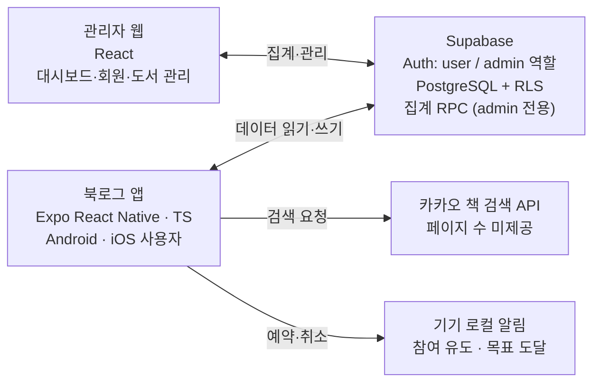

# BookLog MVP PRD (Draft)

> 최종 수정: 2026-10-28 · 작성: 한인웅
> 원본: Claude 문서 「북로그(BookLog) MVP PRD 초안」. 이 파일은 저장소에서 사람과 AI 에이전트가 참고하기 위한 사본이다.

## 1. 개요

북로그는 독서 목표를 하루 단위의 작은 행동으로 나누고, 독서를 시작하고 이어가도록 돕는 모바일 독서 습관 앱이다. 이 문서는 수업 기간(9~15주)에 구현할 MVP의 요구사항을 정의한다.

**배경·문제**

- 성인 연간 종합독서율은 2023년 43.0%에서 2025년 38.5%로 4.5%p 떨어졌다 (문화체육관광부 「2025년 국민 독서실태 조사」).
- 20대 종합독서율은 75.3%로 높지만, 읽고 싶은 마음이 있어도 지속하지 못하는 사용자층이 핵심 타깃이다.
- 기존 독서 앱(북모리, 북적북적)은 기록에 강하지만 독서를 시작·유지·재개하게 만드는 장치가 약하고, 습관 앱(루티너리)은 독서 맥락과 연결되지 않는다.

**해결할 문제 3가지**

| # | 문제 | 해결 방안 |
| --- | --- | --- |
| 1 | 결과 중심 목표라 오늘 얼마나 읽을지 기준이 없음 | 분·페이지 단위 행동 목표 설정 |
| 2 | 습관 유도 기능이 없거나, 기록과 동떨어져 능동적 유도가 없음 | 독서 데이터와 연동한 맥락 알림 + 진행 기반 보상 |
| 3 | 기록 방식이 부담스러움 (구절·생각 직접 타이핑) | 인덱스: 페이지와 짧은 제목으로 기록, 문장은 선택 |

**제품 목표**

1. 부담 없는 목표로 독서를 시작하게 한다.
2. 읽는 동안 집중을 유지하게 한다.
3. 기억하고 싶은 내용을 가볍게 남기게 한다.
4. 과정과 결과를 시각적으로 확인하게 한다.
5. 멈춘 책을 다시 펼치게 한다.

## 2. 대상 사용자와 핵심 시나리오

주 사용자는 독서 의향은 있지만 꾸준히 읽지 못하는 20대이고, 운영자는 관리자 웹으로 서비스 지표와 데이터를 관리한다.

| 사용자 | 설명 | 주요 사용 채널 |
| --- | --- | --- |
| 일반 사용자 (user) | 책을 사 두고도 끝까지 못 읽는 20대 대학생·직장인 | 모바일 앱 (Android·iOS) |
| 운영자 (admin) | 서비스 지표 확인, 회원 이용 정지, 도서 정보 정정 | 관리자 웹 |

**핵심 사용 흐름:** 목표 설정 → 오늘의 독서(타이머) → 기록 → 스트릭 반영 → 인사이트 → 다시 독서

**시나리오 (스토리보드 기준)**

1. **시작하기:** 첫 실행 시 온보딩에서 "하루 15분" 같은 목표와 요일·알림 시간을 정한다. 홈에 오늘의 목표 카드가 나타난다.
2. **책 고르고 읽기:** 책을 검색해 서재에 추가하고 총 페이지를 입력한다. 책 상세에서 독서를 시작하면 집중 독서 모드가 켜지고, 앱을 벗어났다 돌아오면 반응 메시지가 뜬다.
3. **읽으며 남기기:** 읽다가 인덱스(페이지 + 짧은 제목)를 남긴다. 독서를 끝내면 끝 페이지와 한줄평을 입력하고, 다 읽으면 별점·총평으로 완독 처리한다.
4. **기록 확인하기:** 기록 탭에서 캘린더·주간 달성률·연속 독서일을, 인사이트 탭에서 달성률 카드를 본다.
5. **다시 시작하기:** 목표 요일에 읽지 않으면 알림이 온다. 서재에서 오래 안 읽은 책에 쌓인 먼지를 스와이프로 털면 바로 독서가 시작된다.

## 3. MVP 범위

MVP는 핵심 사용자 흐름과 특수 기능 3종(★)을 단순 버전으로 구현하고, 연출·자동화·운영 기능은 학기 이후(P1·P2)로 미룬다.

**포함 (P0, 9~15주)**

- 로그인 생략 (테스트 계정 자동 로그인), 관리자 권한
- 목표 설정 (시간·페이지·요일·알림 시간), 온보딩, 설정 화면
- 도서 검색·등록·서재·상태 관리, 책 상세
- 타이머·페이지 기록·세션 저장
- ★ 집중 독서 모드, 목표 도달 알림
- ★ 인덱스 (페이지 + 짧은 제목)
- 완독 처리 (별점·총평)
- 캘린더·달성률·연속 독서일, 인사이트 달성률 카드, 홈 화면
- ★ 책꽂이 성장 UI·먼지털이 (단순 버전)
- 참여 유도 알림 (고정 문구)
- 관리자 웹: 대시보드·회원 관리·도서 관리

**제외**

| 단계 | 기능 |
| --- | --- |
| P1 (고도화) | 회원가입·로그인 화면, 독서 노트·모아보기, 상세 통계·리포트, 반복 미달성 시 목표 수정 안내, 먼지털이 효과·책꽂이 연출 고도화, 수동 도서 등록·표지·바코드, 관리자 알림 관리·운영 설정·공지 |
| P2 (확장) | 인덱스 공유 카드, AI 독서 회고, 고급 알림, 베타 테스트·출시 준비 |

원격 푸시는 관리자 공지(P1)에만 쓰이므로 MVP는 로컬 알림만 구현한다.

## 4. 기능 요구사항

요구사항은 8개 모듈 30개이며, 각 항목의 수용 기준을 통과하면 완료로 본다. ★는 특수 기능이다.

상태 값은 `미착수` → `진행 중` → `완료` 순서로 바꾸며, 구현 PR에서 함께 갱신한다 (AGENTS.md의 Documentation Rules 참고).

### 4.1 회원·권한 (AUTH)

| ID | 요구사항 | 수용 기준 | 상태 |
| --- | --- | --- | --- |
| AUTH-01 | 테스트 계정 자동 로그인 | 앱 실행 시 미리 만든 테스트 계정으로 Supabase에 자동 로그인되어 user_id가 정해진다. 회원가입·로그인 화면은 P1 | 미착수 |
| AUTH-02 | 역할 분기 | role=user는 앱, role=admin은 관리자 웹에만 진입한다. 이용 정지된 계정은 로그인 후 안내 화면에서 멈춘다 | 미착수 |
| AUTH-03 | 데이터 접근 제한 | RLS로 본인 데이터만 읽고 쓸 수 있다 | 미착수 |

### 4.2 목표·온보딩·설정 (GOAL)

| ID | 요구사항 | 수용 기준 | 상태 |
| --- | --- | --- | --- |
| GOAL-01 | 온보딩 목표 설정 | 첫 로그인 시 단위(분/페이지), 목표량, 요일, 알림 시간을 입력해야 홈으로 이동한다 | 미착수 |
| GOAL-02 | 목표 수정 | 수정 시 이전 목표에 종료일이 기록되고 새 목표가 적용 시작일과 함께 저장된다. 지난 날짜의 달성률은 당시 목표 기준으로 계산된다 | 미착수 |
| GOAL-03 | 설정 화면 | 목표 수정, 알림 시간 변경, 알림 켜기·끄기를 할 수 있다 | 미착수 |

### 4.3 도서·서재 (BOOK)

| ID | 요구사항 | 수용 기준 | 상태 |
| --- | --- | --- | --- |
| BOOK-01 | 도서 검색 | 검색어 입력 시 카카오 책 검색 API 결과(표지·제목·저자·출판사)가 목록으로 표시된다 | 미착수 |
| BOOK-02 | 도서 등록 | 선택한 도서가 Book에 저장되고(ISBN 중복 시 기존 행 재사용), 총 페이지를 입력하면 UserBook이 생성된다. 총 페이지는 1 이상의 정수만 허용한다 | 미착수 |
| BOOK-03 | 독서 상태 관리 | 읽고 싶음·읽는 중·완독·중단 중 하나로 바꿀 수 있고, 서재 탭별 목록에 즉시 반영된다 | 미착수 |
| BOOK-04 | 책 상세 | 진행률(현재/총 페이지), 인덱스 목록, 독서 시작 버튼을 보여준다 | 미착수 |

### 4.4 독서 세션 (READ)

| ID | 요구사항 | 수용 기준 | 상태 |
| --- | --- | --- | --- |
| READ-01 | 독서 타이머 | 시작 시각을 저장하고 경과 시간을 `현재 − 시작`으로 계산한다. 앱이 백그라운드에 있다 돌아와도 시간이 맞다 | 미착수 |
| READ-02 | ★ 집중 독서 모드 | 세션 중 앱이 background → active로 바뀌면 반응 메시지를 표시하고 이탈 횟수를 1 올린다 | 미착수 |
| READ-03 | 목표 도달 알림 | 타이머 시작 시 남은 목표 시간 뒤로 로컬 알림을 예약하고, 그 전에 종료하면 예약을 취소한다 | 미착수 |
| READ-04 | 독서 종료·세션 저장 | 끝 페이지·한줄평 입력 후 ReadingSession이 저장되고, UserBook의 현재 페이지·마지막 독서일이 갱신된다. 독서 시간·이탈 횟수 요약이 표시된다 | 미착수 |
| READ-05 | 완독 처리 | 별점(1~5)·총평 입력 시 Review가 저장되고 상태=완독, 완독일이 기록되며 책꽂이에 추가된다 | 미착수 |

### 4.5 ★ 인덱스 (INDEX)

| ID | 요구사항 | 수용 기준 | 상태 |
| --- | --- | --- | --- |
| INDEX-01 | 인덱스 추가 | 페이지와 짧은 제목은 필수, 문장·색상·태그는 선택이다. 독서 중과 책 상세 양쪽에서 추가할 수 있다 | 미착수 |
| INDEX-02 | 인덱스 목록 | 책 상세에서 페이지 오름차순으로 표시된다 | 미착수 |

### 4.6 기록·시각화·책꽂이 (VIEW)

| ID | 요구사항 | 수용 기준 | 상태 |
| --- | --- | --- | --- |
| VIEW-01 | 캘린더 | 기록 탭에서 월별 캘린더에 독서한 날이 표시된다 | 미착수 |
| VIEW-02 | 달성률 | 날짜별 세션 합계를 그날 적용된 목표량과 비교해 계산한다 (저장하지 않는 계산값). 주간 그래프로 표시한다 | 미착수 |
| VIEW-03 | 연속 독서일 | 오늘까지 끊기지 않고 목표를 채운 일수를 표시한다 | 미착수 |
| VIEW-04 | 인사이트 달성률 카드 | 인사이트 탭에서 주·월 달성률 카드를 표시한다 | 미착수 |
| VIEW-05 | 홈 화면 | 오늘의 목표 카드(진행·독서 시작), 현재 읽는 책, 연속 독서·달성률 요약, 책꽂이 미리보기를 보여준다 | 미착수 |
| VIEW-06 | ★ 책꽂이 | 완독 도서가 페이지 수(두께) 규칙에 따라 책꽂이에 배치된다 | 미착수 |
| VIEW-07 | ★ 먼지털이 | 읽는 중 도서는 마지막 독서일 경과일로 먼지 단계(0~3)를 계산해 이미지로 표시한다. 스와이프하면 DustWipeLog가 기록되고 독서 시작 화면으로 이동한다 | 미착수 |

### 4.7 알림 (NOTI)

| ID | 요구사항 | 수용 기준 | 상태 |
| --- | --- | --- | --- |
| NOTI-01 | 알림 권한 | 온보딩에서 권한을 요청하고, 거부 시 설정 화면에서 다시 안내한다 | 미착수 |
| NOTI-02 | 참여 유도 알림 | 목표 요일·알림 시간에 로컬 알림을 예약한다. 그날 목표를 달성하면 예약을 취소하고, 미달성이면 고정 문구로 발송한다. 발송 내역은 NotificationLog에 기록한다 | 미착수 |

### 4.8 관리자 웹 (ADMIN)

| ID | 요구사항 | 수용 기준 | 상태 |
| --- | --- | --- | --- |
| ADMIN-01 | 관리자 로그인 | admin 계정만 로그인되고, 그 외 계정은 차단된다 | 미착수 |
| ADMIN-02 | 대시보드 | 가입자·활성 사용자·세션 수·달성률·재개율·전환율을 지표 카드로 표시한다. 집계값만 보여주고 인덱스·한줄평 같은 원문은 노출하지 않는다 | 미착수 |
| ADMIN-03 | 회원 관리 | 회원 목록 조회·검색, 이용 정지·해제가 된다 | 미착수 |
| ADMIN-04 | 도서 관리 | 도서 목록 조회·검색, 페이지 수 누락·오류 정보를 수정할 수 있다 | 미착수 |

## 5. 화면 구성

앱은 하단 탭 4개(홈·서재·기록·인사이트)와 탭 밖 화면으로, 관리자 웹은 3개 메뉴로 구성한다.

| 구분 | 화면 | 주요 요소 | 관련 요구사항 |
| --- | --- | --- | --- |
| 진입 | 자동 로그인 (화면 없음) | 테스트 계정 로그인 후 온보딩으로 이동 | AUTH-01 |
| 진입 | 온보딩 | 목표 단위·목표량·요일·알림 시간, 알림 권한 요청 | GOAL-01, NOTI-01 |
| 탭 | 홈 | 오늘의 목표 카드, 현재 읽는 책, 연속 독서·달성률, 책꽂이 미리보기 | VIEW-05 |
| 탭 | 서재 | 상태별 탭(읽고 싶음·읽는 중·완독·중단), 책꽂이, 먼지털이 | BOOK-03, VIEW-06, VIEW-07 |
| 탭 | 기록 | 월 캘린더, 주간 달성률 그래프, 연속 독서일 | VIEW-01~03 |
| 탭 | 인사이트 | 주·월 달성률 카드 | VIEW-04 |
| 탭 밖 | 책 검색 | 검색창, 결과 목록, 총 페이지 입력 | BOOK-01, BOOK-02 |
| 탭 밖 | 책 상세 | 진행률, 상태 변경, 인덱스 목록, 독서 시작, 완독 처리 | BOOK-04, INDEX-02, READ-05 |
| 탭 밖 | 집중 독서 | 타이머, 이탈 반응 메시지, 인덱스 추가, 독서 종료 | READ-01~04, INDEX-01 |
| 탭 밖 | 설정 | 목표 수정, 알림 시간, 알림 켜기·끄기, 로그아웃 | GOAL-02, GOAL-03 |
| 관리자 웹 | 대시보드 | 지표 카드 6개 | ADMIN-02 |
| 관리자 웹 | 회원 관리 | 목록·검색·이용 정지 | ADMIN-03 |
| 관리자 웹 | 도서 관리 | 목록·검색·정보 수정 | ADMIN-04 |

## 6. 데이터 모델

MVP는 기획서 ERD 중 9개 테이블을 쓰고, Note·NotificationTemplate·AppSetting은 P1에서 추가한다. 필드는 기획서 ERD 기준이며, 요구사항에서 새로 필요해진 필드는 (추가)로 표시했다.

| 테이블 | 주요 필드 | 관계 |
| --- | --- | --- |
| User | user_id(PK), 닉네임, 이메일, 역할(user/admin), 이용 정지 여부(추가) | 1:N UserBook, ReadingGoal |
| Book | ISBN(PK), 제목, 저자, 표지, 총 페이지 | 1:N UserBook |
| UserBook | user_id(FK), book_id(FK), 독서 상태, 현재 페이지, 시작일·완독일, 마지막 독서일 | 1:N ReadingSession, DustWipeLog · 1:1 Review |
| ReadingGoal | user_id(FK), 단위, 목표량, 요일, 알림 시간, 적용 시작일, 종료일(추가) | 1:N NotificationLog |
| ReadingSession | user_book_id(FK), 시작·종료 시각, 독서 시간, 시작·끝 페이지, 집중 이탈 횟수, 한줄평 | 1:N Index |
| Index | session_id(FK), 페이지, 짧은 제목, 문장(선택), 색상, 태그 | — |
| Review | user_book_id(FK), 별점, 총평 | — |
| DustWipeLog | user_book_id(FK), 털어낸 시각, 먼지 단계 | — |
| NotificationLog | goal_id(FK), 알림 종류, 발송 시각, 이후 독서 여부 | — |

**계산값 (저장하지 않음):** 달성률, 연속 독서일, 먼지 단계, 책꽂이 배치. 매번 세션·목표 데이터에서 계산한다.

**확인 필요:** Index가 session_id에 묶여 있어 세션 밖(책 상세)에서 추가한 인덱스를 어디에 연결할지 정해야 한다. user_book_id를 함께 두고 session_id를 선택 값으로 바꾸는 방안을 제안한다.

## 7. 비기능 요구사항

| 구분 | 요구사항 |
| --- | --- |
| 플랫폼 | Android·iOS 모두 Expo Go 또는 개발 빌드로 실행된다. 시연은 실기기 기준 |
| 정확성 | 타이머는 백그라운드·화면 꺼짐 후에도 오차 없이 경과 시간을 계산한다 |
| 알림 | 로컬 알림은 앱이 종료된 상태에서도 예약 시각에 발송된다 |
| 보안 | 모든 사용자 테이블에 RLS 적용. 관리자 집계는 admin만 호출할 수 있는 RPC로만 제공한다 |
| 개인정보 | 관리자 웹은 인덱스·한줄평·총평 원문을 노출하지 않는다 |
| 비밀값 | Supabase 키·카카오 REST 키는 환경변수로 관리하고 GitHub에 올리지 않는다 |
| 외부 API | 카카오 책 검색 무료 한도 일 30만 건 안에서 사용한다. 검색은 입력 후 디바운스로 호출 횟수를 줄인다 |

## 8. 기술 스택·시스템 구성

앱(Expo React Native)과 관리자 웹(React)이 Supabase 하나를 백엔드로 함께 쓰고, 도서 정보는 카카오 API, 알림은 기기 로컬 알림으로 처리한다.

| 영역 | 선택 |
| --- | --- |
| 앱 | Expo React Native + TypeScript (Android·iOS 동시) |
| 관리자 웹 | React |
| 백엔드·DB | Supabase (Auth, PostgreSQL, RLS, RPC) |
| 외부 API | 카카오 책 검색 REST API |
| 알림 | 로컬 알림 (MVP). 원격 푸시는 P1 관리자 공지에서 도입 |
| 협업 도구 | VS Code, Figma, GitHub, AI 에이전트(Claude Code, Codex) |

## 9. 성공 지표

수업 MVP의 성공은 15주 시연에서 핵심 흐름이 끊김 없이 동작하는 것이고, 관리자 대시보드 지표는 사용자 테스트 데이터로 확인한다.

**완료 기준 (15주)**

- [ ] P0 요구사항 30개가 수용 기준을 통과한다
- [ ] 시나리오 1~5가 실기기(Android·iOS 각 1대)에서 끊김 없이 시연된다
- [ ] 사용자 테스트 참여자가 온보딩부터 첫 독서 세션 저장까지 도움 없이 마친다

**대시보드 지표 정의 (초안, 확정 필요)**

| 지표 | 정의 (제안) |
| --- | --- |
| 활성 사용자 | 최근 7일 안에 세션을 1회 이상 저장한 사용자 수 |
| 세션 수 | 기간 내 저장된 ReadingSession 수 |
| 달성률 | 목표 요일 중 목표를 채운 날의 비율 (전체 사용자 평균) |
| 재개율 | 먼지털이 또는 참여 유도 알림 뒤 24시간 안에 세션을 시작한 비율 |
| 전환율 | 가입자 중 첫 세션을 저장한 사용자 비율 |

## 10. 일정·역할 분담

기능 단위로 끝까지 맡는 방식으로 나눴다. 한인웅은 데이터 기반·도서·목표·관리자 웹을, 한예찬은 앱 골격·독서 세션·알림·특수 기능 2종을 맡는다.

| 주차 | 한인웅 | 한예찬 |
| --- | --- | --- |
| 9주 | DB·RLS, 테스트 계정 자동 로그인·역할 분기, 카카오 키 | Expo 초기화, 탭 골격, 공통 컴포넌트 |
| 10주 | 도서 검색·등록 (BOOK-01~02) | 독서 타이머 (READ-01) |
| 11주 | 서재·책 상세 (BOOK-03~04) | 세션 저장·달성률 유틸 (READ-04) |
| 11~12주 | 온보딩·목표 (GOAL-01~02), ★ 인덱스 | ★ 집중 모드 (READ-02), 알림 권한·참여 유도 (NOTI-01~02) |
| 12주 | 완독 처리 (READ-05), 설정 (GOAL-03) | 목표 도달 알림 (READ-03) |
| 12~13주 | 관리자 웹: 로그인·지표 정의·집계 RPC | 기록 탭 (VIEW-01~03) |
| 13~14주 | 관리자 웹: 대시보드·회원·도서 관리 | ★ 책꽂이·먼지털이 (VIEW-06~07) |
| 14주 | 홈·인사이트 카드 (VIEW-04~05) | 실기기 테스트 (알림·집중 모드) |
| 15주 | 통합 테스트·사용자 테스트·시연 (공동) | 〃 |

**맞춰야 할 접점**

1. 9주 말: 테이블 스키마·TS 타입·Supabase 호출 함수 규칙(한인웅), 탭 구조·공통 컴포넌트(한예찬)를 먼저 머지한다.
2. 11주: 세션 저장이 갱신하는 UserBook 필드(현재 페이지, 마지막 독서일)의 이름과 시점을 정한다.
3. 11~12주: 목표 저장 후 호출할 알림 예약 함수의 이름·인자를 정한다.
4. 11주: 달성률 유틸 하나를 홈·인사이트·관리자 지표가 함께 쓴다.
5. 책 상세의 독서 시작 → 집중 독서 화면으로 넘기는 파라미터(userBookId)를 정한다.

## 11. 미결 사항·리스크

**미결 사항**

- [ ] 먼지 단계 기준일 (예: 3·7·14일) — MVP는 상수로 고정
- [ ] 책꽂이 두께 규칙: 페이지 수 구간과 두께 매핑
- [ ] 연속 독서일 기준: 목표 요일만 셀지, 매일 셀지
- [ ] Index와 세션·UserBook의 연결 방식 (6장 참고)
- [ ] 대시보드 지표 계산식 확정 (9장 참고)
- [ ] 인덱스 담당 이동(한예찬 → 한인웅) 팀 합의

**리스크**

| 리스크 | 영향 | 대응 |
| --- | --- | --- |
| 타이머·세션 구조(10~11주)가 늦어짐 | 집중 모드, 목표 도달 알림, 달성률, 먼지털이가 모두 밀림 | 11주 말까지 POC 완료를 첫 번째 마감으로 둔다 |
| iOS·Android 백그라운드·알림 동작 차이 | 시연에서 알림 미발송·타이머 오차 | 12주부터 실기기 2종으로 계속 테스트 |
| 카카오 API 응답에 페이지 수 없음 | 달성률·책꽂이 두께 계산 불가 | 등록 시 총 페이지 입력 필수, 관리자 웹에서 정정 |
| 카카오 REST 키가 앱 번들에 노출 | 키 남용 가능 | MVP는 그대로 진행, 여유 시 Supabase Edge Function 경유 |
| React Native·Supabase 경험 부족 | 초반 속도 저하 | 9주에 공통 세팅을 먼저 끝내고 예제 코드로 규칙 공유 |
